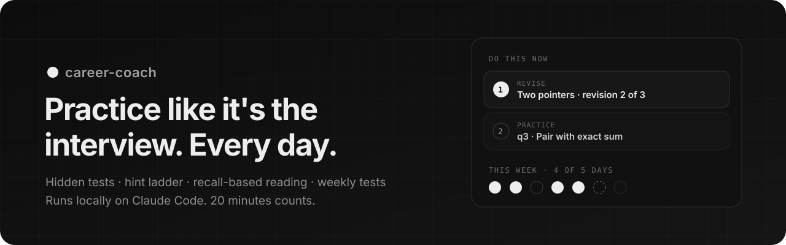
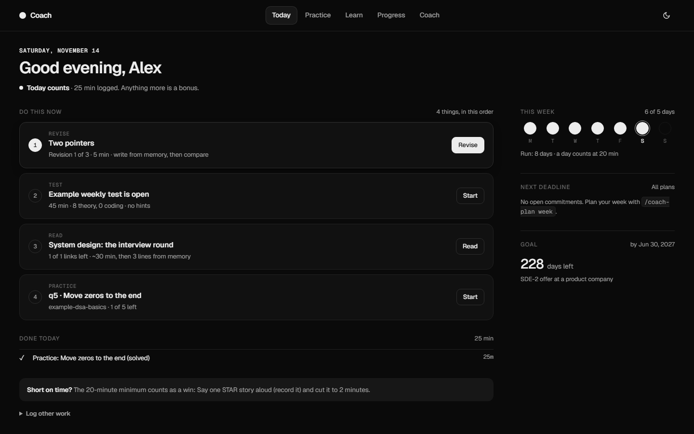
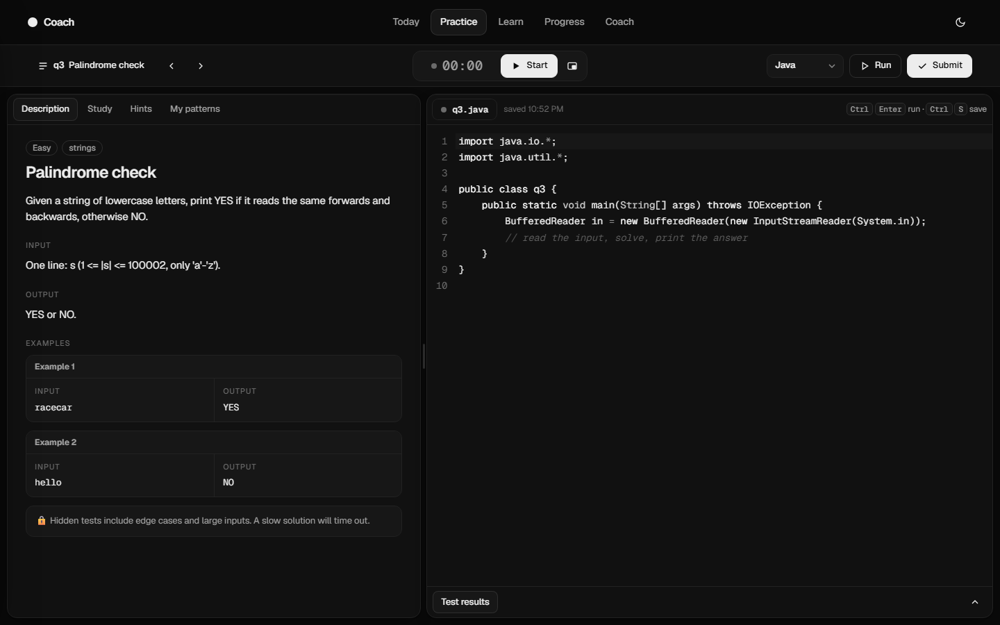
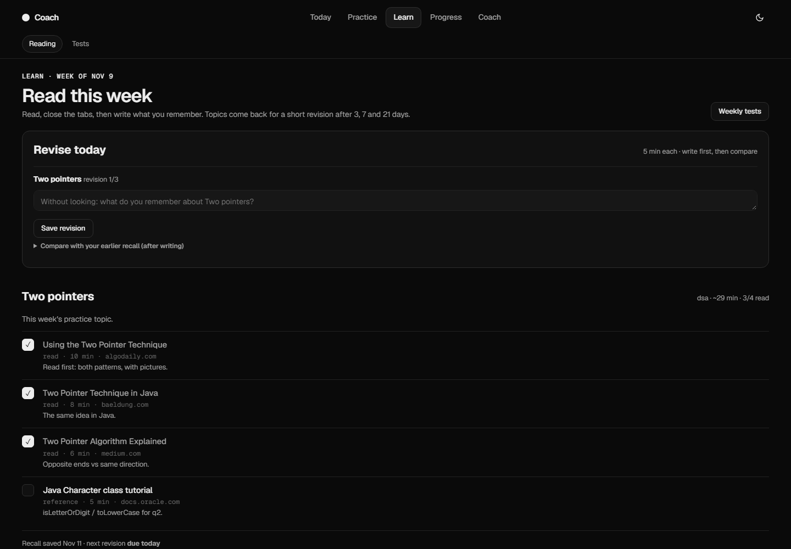
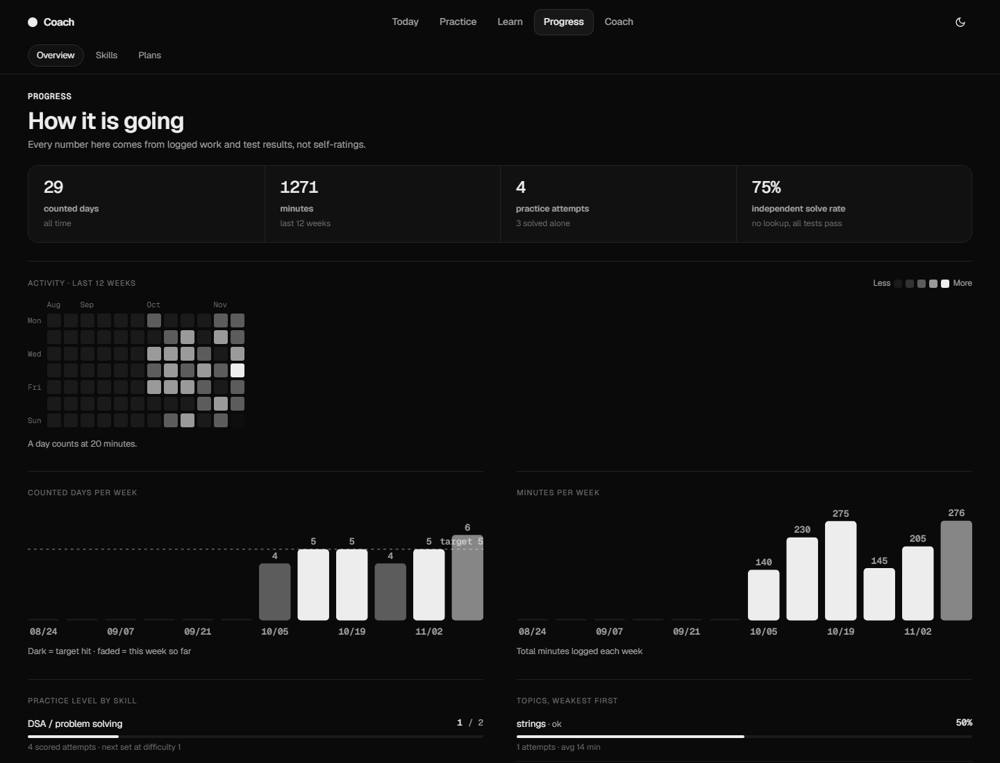
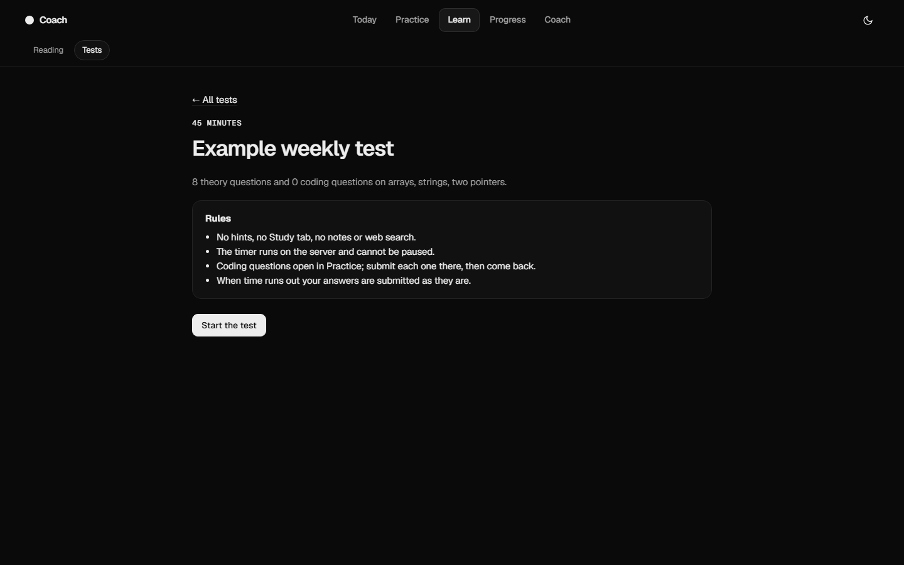
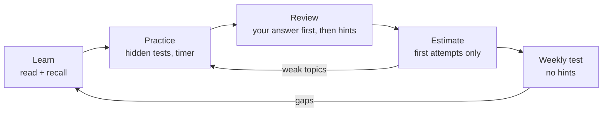

<p align="center">
  
</p>

<p align="center">
  <a href="LICENSE"></a>
  
  
  
  
  <a href="https://github.com/veer0401/career-coach/stargazers"></a>
</p>

<p align="center">
  <b>A local interview and career coach that runs on Claude Code.</b><br>
  It builds practice sets with hidden tests, makes you answer first, hints one rung at a time,<br>
  and moves your skill levels only on evidence. A tiny daily minimum keeps you going.
</p>

<p align="center">
  <a href="#quick-start">Quick start</a> ·
  <a href="#features">Features</a> ·
  <a href="#screenshots">Screenshots</a> ·
  <a href="#coach-commands">Commands</a> ·
  <a href="#how-it-works">How it works</a> ·
  <a href="#faq">FAQ</a>
</p>

<p align="center">
  
</p>

---

## Why

Most prep tools assume you will show up. The real problem is usually different: a strong 2-3 days, then nothing. career-coach is built around that failure mode:

- **20 minutes counts as a win.** Every day has a minimum task that is always enough.
- **Never miss twice.** After a missed day you get a 10-minute comeback task, not a guilt trip.
- **Evidence, not vibes.** Your level comes from code that passes hidden tests on the first try, not from how confident you feel.
- **You answer first.** Hints come one rung at a time; solutions unlock only after you submit or give up.

No API key and no cloud service of its own: Claude Code is the runtime, a Python standard-library server is the dashboard, and your progress is plain JSON files on your machine.

## Features

| | |
|---|---|
| **Today board** | One ordered list: continue a paused question, revisions due, an open weekly test, this week's reading, the next unsolved question. Plus counted days, the next deadline and days to your goal. |
| **Practice with hidden tests** | Java, Python or JavaScript, stdin to stdout. Every set is cross-checked: brute force and optimal references agree on random inputs, and a max-size test makes brute force time out. |
| **Server-side timer** | Survives closed tabs; pop-out always-on-top timer; pause reasons, idle time and tab switches feed your pattern report. |
| **Hint ladder** | Hint 1, 2, 3, then simplest / ideal / optimized solutions, each one run against the tests before you see it. Any hint counts as half credit. |
| **Learn with recall** | A short, sourced reading list per topic. Mark links read, close them, write 3 lines from memory. Topics return for 5-minute revisions after 3, 7 and 21 days. |
| **Weekly tests** | 45 minutes, no hints: multiple choice graded instantly, short written answers graded against a rubric, coding with hints locked. Answers never reach the browser before you submit. |
| **Honest progress** | Counted-days heatmap, minutes per week, level per skill from test results, weakest topics first, where you get stuck and why you pause. |
| **Plans with teeth** | Goals and weekly plans measured from logged work. Missed items become debts; optional penalties you agree to in advance. |
| **Coach chat** | A chat page that runs Claude Code in this folder, with history. |

## Screenshots

<table>
  <tr>
    <td width="50%"><p align="center"><sub><b>Practice</b>: editor, server timer, Study and Hints tabs</sub></p></td>
    <td width="50%"><p align="center"><sub><b>Learn</b>: read, close, recall; revisions come back on schedule</sub></p></td>
  </tr>
  <tr>
    <td width="50%"><p align="center"><sub><b>Progress</b>: counted days, minutes, levels from test results</sub></p></td>
    <td width="50%"><p align="center"><sub><b>Weekly test</b>: timed, no hints, graded after submit</sub></p></td>
  </tr>
</table>

<sub>Screenshots use a demo profile with sample data.</sub>

## Quick start

**Requirements:** [Claude Code](https://claude.com/claude-code) (logged in) · Python 3.10+ · Java 17+ for Java practice (Python/Node optional)

```bash
git clone https://github.com/veer0401/career-coach
cd career-coach

# 1. Tell it who you are: edit data/config.json (name, goal, goal_date, minutes per day)

# 2. Open the dashboard
python -I coach.py dashboard          # http://127.0.0.1:8765

# 3. In another terminal, start Claude Code in this folder
claude
/coach-verify dsa                     # an honest starting level for one skill
/coach-set dsa arrays 5               # a practice set with hidden tests at your level
```

Solve on the Practice page, submit, then tell the coach `review q1`. An example set (`practice/example-dsa-basics`) and an example weekly test are included so every page works straight away.

## Coach commands

| Command | What it does |
|---|---|
| `/coach-set [skill] [topic] [n]` | Builds a question set with hidden tests, hints and verified solutions at your level |
| `/coach-review` | Analyses your attempt first, records it, then shows simplest / ideal / optimized solutions |
| `/coach-verify KEY` | Diagnostic quiz that sets an honest level for one skill |
| `/coach-test build \| grade` | Builds the weekly test; grades written answers after you submit |
| `/coach-plan goals \| week \| month \| review` | Measurable goals and plans with fixed deadlines |
| `/coach-week` | Weekly review: stats, news, re-ranked weak areas, next week's plan and reading |
| `/coach-news` | Sourced market and tech news scan; adjusts skill weights |
| `/coach-notes` | Builds a notes library per topic from what you actually solved |

## How it works



How levels stay honest:

| Signal | Source |
|---|---|
| Correct or not | Your code against hidden tests, including a large input where brute force times out |
| Lookup | Any hint or reveal; counts half credit |
| Pace | Time per question on the server timer (targets are recorded but never shown, so they don't become pressure) |
| Level change | Only from 5+ first attempts, at most +1.0 / -0.5 per run |

<details>
<summary><b>Project layout</b></summary>

```
coach.py, planner.py      CLI: today, done, status, run, attempt, estimate, dashboard, plans
dashboard/                local web app (stdlib HTTP server + plain HTML/JS, no build step)
.claude/skills/           the coach's skills (Claude Code)
practice/<set>/set.json   question sets with tests, hints, solutions (your code: qN.java|py|js)
tests/<id>/test.json      weekly tests
data/                     your config, skills and progress (JSON / JSONL)
notes/                    notes library built from your attempts
scripts/                  optional: daily reminder, weekly review, nightly backup
```
</details>

<details>
<summary><b>Optional automation (Windows)</b></summary>

- `scripts/nudge.ps1`: a notification with today's minimum task, only if the day is not counted yet.
- `scripts/backup.ps1`: commit and push this folder to your own **private** remote.
- `scripts/weekly.ps1`: run `/coach-week` headless.

```powershell
schtasks /create /tn "CareerCoach Nudge" /sc daily /st 20:00 /tr "powershell -NoProfile -WindowStyle Hidden -File <path>\scripts\nudge.ps1"
```
</details>

## FAQ

**Does it send my data anywhere?**
No. The dashboard listens on 127.0.0.1 only, and POSTs need a per-start token. Claude Code talks to Anthropic as it normally does when you chat with the coach; nothing else leaves your machine. The default `.gitignore` keeps your progress and solutions out of git.

**Do I need an API key?**
No. It runs inside Claude Code with your existing login.

**Only DSA?**
DSA is the most developed track. The skill matrix also covers system design, Java, databases, agentic AI, cloud, testing and communication; written-answer questions with rubrics work for any of them.

**Can I use my own questions?**
Yes. Paste them to `/coach-set` and it turns them into a tracked set with tests.

## Contributing

Issues and pull requests are welcome. Keep it dependency-free (standard library Python, plain HTML/JS) and keep the core rules intact: the user answers first, levels move only on evidence, and every shown solution has been run against the tests.

## License

[MIT](LICENSE)
